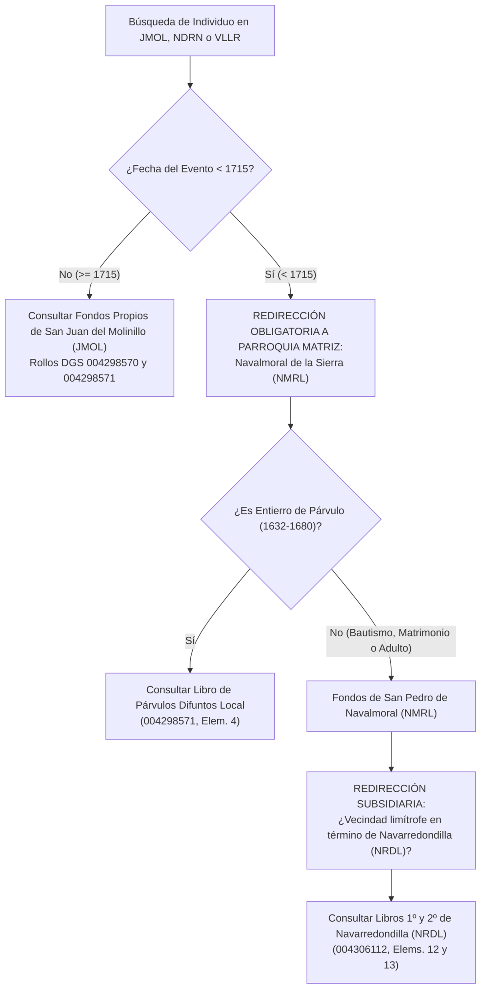

# 04_JURISDICCIONES_Y_DEPENDENCIAS_PARROQUIALES DEL ALTO ALBERCHE
## Geografía Eclesiástica, Jerarquías Parroquiales, Cronología de Series y Protocolo de Redirección (1594–1902)

> **PROPÓSITO DE ESTE DOCUMENTO:**
> Este documento constituye la **Fuente Canónica de Jurisdicción y Cronología Parroquial** para el pipeline de I+D genealógico. Establece los códigos geográficos normalizados de cuatro letras, las relaciones históricas matriz-anejo, los años fundacionales de cada serie sacramental, las lagunas documentales y las reglas algorítmicas de redirección de búsqueda genealógica para personas nacidas o casadas antes de la creación de las parroquias filiales.

---

## 🏛️ 1. CODIFICACIÓN GEOGRÁFICA NORMALIZADA (ESTÁNDAR CUATRILETRADO)

Para evitar la colisión sistemática del prefijo común regional *"NAVA-"* (*Navarredondilla, Navalmoral, Navalacruz, Navandrinal, Navaluenga, Navalosa, Navaquesera*), se establece el siguiente estándar de cuatro letras obligatorio en nombres de cuadernos, actas, IDs y grafos:

| Código | Localidad | Jerarquía Histórica | Parroquia / Titularidad | Jurisdicción Matriz / Abadía |
| :---: | :--- | :--- | :--- | :--- |
| **`NRDL`** | **Navarredondilla** | Parroquia independiente (desde s. XVI) | Iglesia Parroquial de Santiago Apóstol | Abadía de Santa María de Burgohondo (`BHND`), Diócesis de Ávila |
| **`NMRL`** | **Navalmoral de la Sierra** | **Parroquia Matriz Histórica** | Iglesia Parroquial de San Pedro Apóstol | Diócesis de Ávila (fondos en FamilySearch pendientes de catalogar) |
| **`JMOL`** | **San Juan del Molinillo** | Anejo de `NMRL` hasta 1715; Parroquia independiente desde 1715 | Iglesia Parroquial de San Juan Bautista | Dependiente de `NMRL` (pre-1715); libros propios desde 1715 |
| **`NDRN`** | **Navandrinal** | Anejo rural permanente | Parroquia / Ermita de Navandrinal | Anejo de `NMRL` (pre-1715); anejo de `JMOL` (post-1715) |
| **`VLLR`** | **El Villarejo** | Anejo rural permanente | Ermita de El Villarejo | Anejo de `NMRL` (pre-1715); anejo de `JMOL` (post-1715) |
| **`NCRZ`** | **Navalacruz** | Parroquia independiente | Parroquia de Navalacruz | Diócesis de Ávila |
| **`BHND`** | **Burgohondo** | Cabeza de Abadía Colegiata | Abadía de Santa María de Burgohondo | Jurisdicción exenta / Diócesis de Ávila |
| **`NVLS`** | **Navalosa** | Parroquia rural | Parroquia de Navalosa | Diócesis de Ávila |
| **`NVLG`** | **Navaluenga** | Parroquia independiente | Parroquia de Navaluenga | Diócesis de Ávila |
| **`NVTG`** | **Navatalgordo** | Parroquia independiente | Parroquia de Navatalgordo | Diócesis de Ávila |
| **`NVRQ`** | **Navaquesera** | Parroquia rural | Parroquia de Navaquesera | Diócesis de Ávila |
| **`SRRN`** | **Serranillos** | Parroquia independiente | Parroquia de Serranillos | Diócesis de Ávila |

---

## 🗺️ 2. JERARQUÍA HISTÓRICO-ECLESIÁSTICA Y REDIRECCIÓN GENEALÓGICA PRE-1715

### 2.1. El Eje Navalmoral (`NMRL`) $\rightarrow$ San Juan del Molinillo (`JMOL`) y Anejos
* **Situación Canónica Pre-1715:**
  - Los núcleos de **San Juan del Molinillo (`JMOL`)**, **Navandrinal (`NDRN`)** y **El Villarejo (`VLLR`)** carecían de pila bautismal autorizada y de consideración parroquial propia. Formaban parte civil y eclesiástica indivisa de la parroquia matriz de **San Pedro Apóstol de Navalmoral de la Sierra (`NMRL`)**.
  - Los sacerdotes o tenientes residentes en la ermita de San Juan no asentaban bautismos solemnes ni desposorios formales: los vecinos debían desplazarse a Navalmoral de la Sierra para recibir los sacramentos de iniciación y estado.
  - **Única excepción documental local:** El *Libro 1º de Párvulos Difuntos (1632/1644–1680, Rollo DGS 004298571, Elem. 4)*, donde se registraban los entierros de párvulos efectuados en el cementerio anexo a la ermita de San Juan al no justificar el traslado del cadáver del niño hasta la matriz de Navalmoral.
* **Apertura de Registros Propios en 1715:**
  - A partir de **1715** arrancan formalmente los libros parroquiales propios conservados de **San Juan Bautista de San Juan del Molinillo (`JMOL`)**, con pila bautismal y asignación pastoral de los anejos de **Navandrinal (`NDRN`)** y **El Villarejo (`VLLR`)**.
  - **Fondos de Navalmoral de la Sierra (`NMRL`):** Existen libros parroquiales de Navalmoral en FamilySearch. Deben ser localizados por número de rollo DGS, descargados y catalogados en el corpus para posibilitar la reconstrucción documental previa a 1715.

### 2.2. Protocolo Algorítmico de Redirección de Búsqueda Pre-1715
Cuando el sistema de reconstrucción genealógica, el usuario o una consulta en el grafo busque los antecedentes sacramentales de una persona nacida, casada o vecina de **San Juan del Molinillo (`JMOL`)**, **Navandrinal (`NDRN`)** o **El Villarejo (`VLLR`)** en fechas anteriores a 1715:

> [!IMPORTANT]
> **REGLA DE REDIRECCIÓN PRE-1715:**  
> Queda formalmente prohibido reportar *"partida inexistente o perdida por laguna documental"* para nacimientos o matrimonios de Molinillo anteriores a 1715 sin haber consultado los fondos de **Navalmoral de la Sierra (`NMRL`)** y subsidiariamente los de **Navarredondilla (`NRDL`)**.

---

## 📅 3. CRONOLOGÍA DE INICIO DE SERIES Y FONDOS POR LOCALIDAD

Los libros parroquiales NO arrancan simultáneamente en todas las localidades ni para todos los sacramentos. Esta tabla fija las fechas límite inferiores y superiores de cada fondo:

### 3.1. Navarredondilla (`NRDL`) — Archivo Diocesano de Ávila (Sit. Arch. 166/4)
* **Bautismos:**
  - **Libro 1º (Elem. 12, Rollo 004306112):** 23 de enero de **1594** – octubre de **1636** (Folios 1r a 79v).
  - **Libro 2º (Elem. 13 "Cajón de Sastre", Rollo 004306112):** 14 de enero de **1638** – diciembre de **1695** (Folios 1 a 114).
  - **Libro 3º (Elem. 14, Rollo 004306112):** **1697** – **1749**.
  - **Libro 4º (Elem. 15, Rollo 004306112):** **1750** – **1803**.
  - **Libro 5º (Elem. 16, Rollo 004306112):** **1804** – **1828**.
  - **Libros 6º, 7º y 8º (Elems. 1–3, Rollo 004306113):** **1829** – **1889**.
* **Matrimonios:**
  - **Libro 1º (Elem. 12 reverso, Rollo 004306112):** **1634** – **1686** *(No hay libro de matrimonios conservado anterior a 1634)*.
  - **Tramo intercalado (Elem. 13, Rollo 004306112):** **1686** – **1697**.
  - **Libro 2º Bífido (Elem. 6 reverso, Rollo 004306113):** **1698** – **1803**.
  - **Libro 3º en adelante (Rollo 004306113):** **1803** – **1902**.
* **Defunciones:**
  - **Libro 1º (Elem. 13 intercalado, Rollo 004306112):** **1631** – **1701** (Memoria fundacional de Juan Agustín de Fuentes) *(No hay difuntos conservados anteriores a 1631)*.
  - **Libros 2º y 3º (Elems. 4–5, Rollo 004306113):** **1701** – **1767**.
  - **Libro 4º Bífido (Elem. 6 anverso, Rollo 004306113):** **1767** – **1802**.
  - **Libros 5º a 8º (Elems. 7–10, Rollo 004306113):** **1802** – **1902**.

### 3.2. San Juan del Molinillo (`JMOL`) y Anejos — Archivo Diocesano (Sit. Arch. 175/1)
* **Bautismos:**
  - **Libro 1º Fundacional (Elem. 14, Rollo 004298570):** **1715** – **1752** *(Descarta previa: 00001–01598 son de Rivilla de Barajas y Salobral)*.
  - **Libro 2º (Elem. 15, Rollo 004298570):** **1752** – **1800**.
  - **Libro 3º (Elem. 16, Rollo 004298570):** **1801** – **1852**.
  - **Libro Mixto Transicional Nº 4 (Elem. 17, Rollo 004298570):** **1842** – **1850** (intercala bautismos, matrimonios y entierros).
  - **Libro 5º (Elem. 18, Rollo 004298570):** **1851** – **1862**.
  - **Índice General de Bautismos (Elem. 19, Rollo 004298570):** **1750** – **1914**.
* **Matrimonios:**
  - **Libro 1º (Elem. 1, Rollo 004298571):** Septiembre de **1716** – **1756**.
  - **Libro 2º (Elem. 2, Rollo 004298571):** Diciembre de **1756** – **1789**.
  - **Libro 3º (Elem. 3, Rollo 004298571):** **1790** – **1899**.
* **Defunciones:**
  - **Libro 1º de Párvulos Difuntos (Elem. 4, Rollo 004298571):** **1632/1644** – **1680** *(Único registro propio pre-1715)*.
  - **Libros 1º a 6º de Adultos (Elems. 5–10, Rollo 004298571):** **1715** – **1892**.
  - **Índice Alfabético de Difuntos (Elem. 11, Rollo 004298571):** **1893** – **1907** *(Descarta posterior: 01561–02609 corresponden a Grajos / San Juan del Olmo)*.

---

## ⚠️ 4. MAPA DE PATOLOGÍAS FÍSICAS, LAGUNAS Y CUADERNOS MAL ENCUADERNADOS

### 4.1. Navarredondilla: El "Cajón de Sastre" (Elemento 13, Rollo 004306112)
El Elemento 13 es un códice mixto cuya encuadernación se quebró en el siglo XVIII y fue vuelto a coser de manera desordenada mezclando cuadernillos de diferentes sacramentos y décadas.

1. **Laguna Documental Estricta de 1647–1648:**
   - Entre febrero de 1647 (`02067.jpg` izq.) y enero de 1649 (`02071.jpg`) existe una **laguna absoluta por pérdida irreparable de hojas**. No hay bautismos conservados en ese intervalo.
2. **Pliegos Traspapelados e Intercalaciones Anacrónicas:**
   - **Pliego de 1672 en 1658:** En `02085.jpg` (mitad derecha) está cosido un pliego suelto de **1672** (Gaspar González) entre los asientos de 1658 (`02085.jpg` izq.) y 1659 (`02086.jpg`).
   - **Crisis de Sacristía (1664–1676, `02100.jpg`–`02102.jpg`):**
     * `02100.jpg`: Izq. = Bautismos oct-nov 1676; Dcha. = Bautismo abr-1664 + índice borrador a dos columnas de 1668 y 1669.
     * `02101.jpg`: Izq. = Minutas sueltas de 1670–1672; Dcha. = Bautismos 1665–1666 + Defunción de 1674.
     * `02102.jpg`: Izq. = Collage de recortes y tiras de papel cosidas de 1673 a 1675; Dcha. = Folio formal 43 del año 1666.
     * `02109.jpg`–`02111.jpg`: Auto de Visita de 1680 ordenando al cura recomponer de urgencia las partidas no asentadas de la década anterior a partir de minutas volantes.
   - **Desorden de Folios 70 a 73 (1682–1684):** La secuencia cronológica real es:
     $$\text{Img } 02121 \text{ (1682)} \longrightarrow \text{Img } 02120 \text{ (1682/1684)} \longrightarrow \text{Img } 02122 \text{ (1683)} \longrightarrow \text{Img } 02119 \text{ (1684)}$$
   - **Retales Finales (1665–1668, `02148.jpg` a `02152.jpg`):** Fragmentos rasgados cosidos al final del volumen tras el cierre formal del libro en 1695 (`02147.jpg`).

### 4.2. Códices Bífidos (Libros de Doble Entrada Invertida)
* **Navarredondilla Elem. 12 (004306112):**
  - **Entrada Directa (1872–1954):** Bautismos 1º (1594–1636).
  - **Entrada Invertida (1986 retrocediendo hasta 1957):** Libro 1º de Casados (1634–1686).
* **Navarredondilla Elem. 6 (004306113):**
  - **Entrada Directa (0666–0800):** Difuntos 4º (1767–1802).
  - **Entrada Invertida (0800 retrocediendo):** Casados 2º (1698–1803) y despachos matrimoniales forasteros.

### 4.3. Solapamientos Temporales por Apertura de Libros Paralelos (1852–1854)
En la década de 1850 en Navarredondilla, el clero abrió simultáneamente el Libro 6º y el Libro 7º de Bautizados y Defunciones. Las actas de los años **1852 a 1854 están duplicadas o repartidas entre ambos libros**, por lo que deben cotejarse conjuntamente para evitar asentar dos personas distintas donde hay dos asientos del mismo individuo.

### 4.4. Fenómeno Social: Padrón de Expósitos y Nodrizas (1889)
En el Libro 8º de Bautizados (Padrón de 1889) y Libro 7º de Difuntos de Navarredondilla consta una entrada masiva de recién nacidos procedentes de las **Inclusas de Madrid y Ávila** entregados a nodrizas locales para su crianza. Estos asientos registran apellidos convencionales o toponímicos de expósito sin filiación paterna ni materna biológica.

---

## 📋 5. INTEGRACIÓN EN EL PIPELINE Y REGLAS DE ANCLAJE

1. **Etiquetado de Cuadernos en NotebookLM:**  
   Todo cuaderno o lote debe llevar en su metadato inicial el código cuatriletrado (`NRDL`, `NMRL`, `JMOL`, `NCRZ`, `NDRN`, `VLLR`).
2. **Tratamiento de Hojas Sueltas y Minutas:**  
   Toda hoja volante, pliego intercalado o recorte de sacristía descubierto durante el escaneo no debe descartarse ni forzarse como partida ordinaria: debe procesarse mediante el bloque polimórfico correspondiente (`MINUTA_SACRISTIA` o `AUTO_VISITA`).
3. **Mantenimiento Continuo:**  
   Cualquier nuevo desorden o pliego anómalo identificado durante la ejecución de los experimentos debe consignarse inmediatamente en este documento y en [`01_DICCIONARIO_ANCLAJE_NAVARREDONDILLA.md`](file:///c:/TRABAJOS/personal/genealo/01_DICCIONARIO_ANCLAJE_NAVARREDONDILLA.md).
