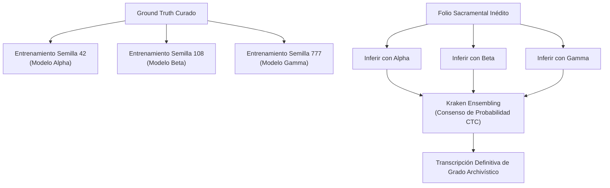

# ESTRATEGIAS Y GUÍA TÉCNICA: ENTRENAMIENTO EXTREMO DE KRAKEN (HTR) — PROYECTO ALTO ALBERCHE

**Ámbito:** Digitalización, Ecdótica y Modelado HTR Paleográfico del Archivo Parroquial y Catastral  
**Motor:** Kraken HTR Engine / CLI `ketos`  
**Plataforma de Ejecución:** Google Compute Engine Spot VM (`escriptorium-spot-vm`) con acelerador **NVIDIA Tesla T4 (16 GB VRAM)**  
**Referencia Archivística:** Siglos XVI al XVIII (Navarredondilla, San Juan del Molinillo, Navandrinal, El Villarejo)  

---

## 1. MODIFICACIÓN DE LA TOPOLOGÍA DE LA RED NEURONAL (CRNN)

La arquitectura por defecto de Kraken está optimizada para hardware modesto. Para la complejidad paleográfica del Alto Alberche, se inyecta una topología personalizada mediante la especificación de red con el parámetro `-s`:

```bash
# Ejemplo de especificación de red CRNN profunda para ketos:
# [1,120,0,3] -> Entrada RGB (3 canales), altura normalizada a 120px
# Convoluciones profundas con filtros 128/256 y MaxPooling
# BiLSTM bidireccional de 256/512 unidades por capa
# Softmax/CTC final
ketos train -s '[1,120,0,3 Cr128,4,2,1,1 Mp1,2,1,2 Cr256,4,2,1,1 Mp1,2,1,2 Lbx256 Do0.5 Lbx256 Do0.5 O1c183]' ...
```

### 1.1 Filtros Convolucionales (CNN) Ampliados
* **De 32/64 a 128/256 filtros:** Permite a la red discriminar características sutiles del soporte físico:
  * Diferenciación de tinta traspasada (*bleed-through* / efecto fantasma del reverso) frente a tinta superficial en el plano focal.
  * Separación de manchas de humedad, oxidación por tintas ferrogálicas y carcoma frente a trazos caligráficos genuinos.

### 1.2 Celdas Recurrentes (BiLSTM) Profundas
* **De 100 a 256 / 512 unidades:** Amplía la memoria secuencial a corto y medio plazo.
* **Impacto Paleográfico:** Vital para resolver la *scriptio continua*, el encadenamiento de nexos y las ligaduras extremas de escribanos procesales (como Gaspar Rubiano, 1616).

### 1.3 Entrada de Color Real (RGB Nativo)
* **Preservación del canal cromático (`[1,120,0,3]`):** Entrenar con imágenes RGB reales en lugar de imágenes binarizadas en blanco y negro (Otsu o Sauvola). El degradado marrón-rojizo de las tintas ferrogálicas frente al amarilleo del papel verjurado contiene información de contraste crítica que la binarización destruye.

---

## 2. AUMENTO DE DATOS AGRESIVO (DATA AUGMENTATION)

Para evitar el sobreajuste (*overfitting*) en corpus reducidos y enseñar a la red a generalizar sobre microfilms defectuosos, se activa la flag `--augment` en `ketos`:

* **Deformación Espacial (Grid / Elastic Distortion):** Emula la curvatura del papel en el lomo de encuadernación, pliegues y alabeos mecánicos del pergamino/papel.
* **Inyección de Ruido Gaussiano y Variación Fotométrica:** Simula desenfoques de lente, variaciones de luz en microfilmadoras manuales de FamilySearch y pérdidas de contraste por tintas desvanecidas.
* **Exigencia de Cómputo:** Estas transformaciones tensoriales en tiempo real saturan una CPU, pero se ejecutan a velocidad nativa en la GPU **NVIDIA Tesla T4** de 16 GB VRAM.

---

## 3. TRANSFERENCIA DE APRENDIZAJE Y CONTROL DE PESOS (TRANSFER LEARNING)

### 3.1 Expansión del Codec (`--resize add`)
Resuelve la limitación de modelos como **TRIDIS** (que carecen de la `ſ` larga):
* Se toma el modelo pre-entrenado y se ejecuta:
  ```bash
  ketos train -B Tridis_Medieval_EarlyModern.mlmodel --resize add -f xml -t train.txt ...
  ```
* Kraken preserva las neuronas convolucionales que ya reconocen trazos medievales y añade nuevas neuronas de salida en la capa CTC para los caracteres ausentes (`ſ` `U+017F`, letras voladas `º`, `ª`, macrones `ā`, `ō`).

### 3.2 Congelación de Capas (`--freeze-backbone`)
* Bloquea los gradientes de las capas convolucionales de visión y fuerza a la GPU a actualizar exclusivamente la cabeza lineal y la capa de caracteres.
* **Ventaja:** Evita el *olvido catastrófico* (*catastrophic forgetting*) cuando se cuenta con pocas páginas de muestra (5 a 10 folios de Ground Truth).

### 3.3 Entrenamiento Purista desde Cero (*From Scratch*)
* Cuando el corpus de Ground Truth curado por Gemini y validado por el Archivero Virtual alcance entre **50 y 100 folios**, se prescinde de modelos foráneos.
* Se entrena una red en blanco que conocerá única y exclusivamente el vocabulario sacramental castellano, la toponimia del Alto Alberche y el ductus de sus sacerdotes.

---

## 4. HIPERPARÁMETROS MATEMÁTICOS DE RENDIMIENTO EN GPU

Aprovechando los 16 GB de VRAM de la Tesla T4:

* **Batch Size Masivo (16 a 32 líneas simultáneas):**
  * `ketos train -B ... --batch-size 32`
  * Estabiliza el cálculo estocástico del gradiente, evitando que un renglón roto o manchado introduzca ruido en la actualización de pesos.
* **Optimizador AdamW con Decaimiento de Tasa Cosenoidal (*Cosine Annealing*):**
  * Supera al SGD tradicional, evitando mínimos locales y garantizando una convergencia suave hacia tasas de error de carácter (CER) inferiores al 3%.

---

## 5. ENSAMBLADO DE MODELOS (MODEL ENSEMBLING POR CONSENSO ESTADÍSTICO)

Estrategia para neutralizar alucinaciones individuales en transcripción de grado archivístico:



* **Comando de inferencia por consenso:**
  ```bash
  ketos trans -m alpha.mlmodel -m beta.mlmodel -m gamma.mlmodel -f xml -o output.xml ...
  ```

---

## 6. INTEGRACIÓN DE DOMINIO Y ESTRATEGIA DE GROUND TRUTH

### 6.1 Micromodelos "Francotiradores" vs. Modelo General
* En lugar de forzar a un solo modelo a entender todas las épocas, se diseñan **micromodelos especializados por amanuense / periodo**:
  * `kraken_rubiano_1615.mlmodel`: Especializado en letra procesal encadenada y abreviaturas del s. XVII.
  * `kraken_calpe_1725.mlmodel`: Especializado en la cursiva humanística transicional del primer Setecientos.
  * `kraken_moya_1758.mlmodel`: Especializado en la redondilla ilustrada con orlas y llamadas de margen.
  * `kraken_ensenada_1752.mlmodel`: Especializado en letra cortesana/procesal tardía de cancillería real.

### 6.2 Ontología en DLA (Document Layout Analysis)
* Entrenar el segmentador geométrico de Kraken no solo para trazar baselines neutras, sino para etiquetar polígonos con valor semántico:
  * `Region_Bautismo`, `Region_Matrimonio`, `Region_Defuncion`.
  * `Margen_Nombres`, `Auto_Visita_Pastoral`.
* **Impacto en el Pipeline:** Al exportar a PAGE-XML o ALTO-XML, cada bloque textual viene predigerido semánticamente, permitiendo ingestas directas en bases de datos de grafos (ArcadeDB / Neo4j) sin necesidad de segmentación textual heurística a posteriori.
