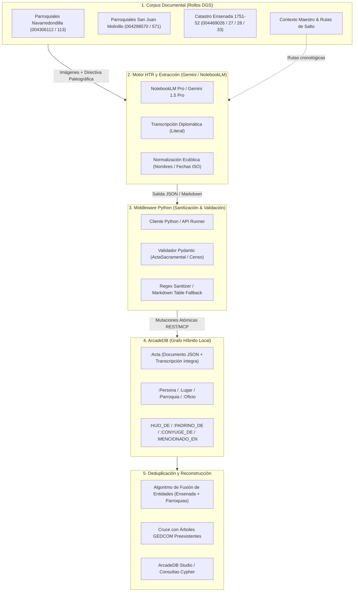
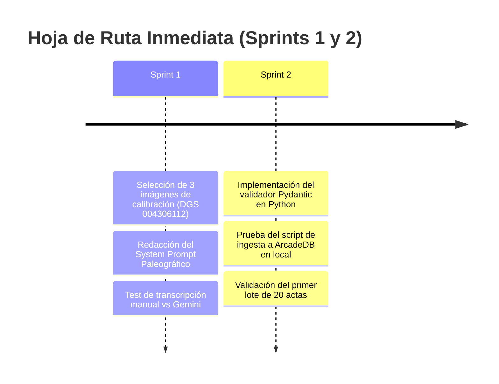

# 📜 PLAN MAESTRO: PIPELINE DE I+D GENEALÓGICO ALTO ALBERCHE
## Transcripción HTR, Extracción Ecdótica y Modelado en Grafo (ArcadeDB)

> [!NOTE]
> **Estado del Plan:** Propuesta de Planificación Estratégica (Modo Planning).  
> **Objetivo:** Automatizar la ingesta y reconstrucción familiar de los libros parroquiales y catastrales del Alto Alberche (1594–1852) combinando visión multimodelo (NotebookLM Pro / Gemini 1.5 Pro), sanitización en Python y base de datos híbrida (ArcadeDB).

---

## 🏛️ 1. Visión y Arquitectura Global del Sistema

El pipeline soluciona los dos grandes desafíos de la paleografía histórica a escala: la asimetría de los manuscritos (letra procesal-cortesana con caligrafías heterogéneas) y los errores severos de encuadernación y catalogación de los rollos microfilmados.



---

## 🧭 2. Desglose Detallado de Fases de Ejecución

### 🟢 FASE 0: Catalogación, Configuración y Verificación del Entorno
*Asegurar que los datos base y las herramientas locales están operativas antes de enviar prompts masivos.*

- [x] **0.1. Base de datos:** ArcadeDB 26.10.2 nativo en Windows (GraalVM, ~110 MB RAM, sin dependencias de Docker).
- [x] **0.2. Contexto de saltos:** [Contexto_Maestro_IA_Genealogia.md](file:///c:/TRABAJOS/personal/genealo/Contexto_Maestro_IA_Genealogia.md) consolidado con las correcciones de FamilySearch (Cajón de sastre del Rollo 004306112 y ocultamiento de Navandrinal en 004469028).
- [ ] **0.3. Mapeo de inventarios:** Indexar las imágenes descargadas en [imagenes/](file:///c:/TRABAJOS/personal/genealo/imagenes) con los rangos exactos de los inventarios PDF ([inventario-navarredondilla-v3.pdf](file:///c:/TRABAJOS/personal/genealo/imagenes/inventario-navarredondilla-v3.pdf)).
- [ ] **0.4. Verificación de conectividad:** Confirmar el funcionamiento del endpoint HTTP (`http://localhost:2480/api/v1/command`) y credenciales de ArcadeDB.

---

### 🔬 FASE 1: Laboratorio de Prompt Engineering y Directiva Paleográfica
*Objetivo: Obtener de NotebookLM/Gemini lecturas fieles al manuscrito sin resúmenes, omisiones ni deformación de apellidos.*

> [!IMPORTANT]
> **Principio de Doble Capa:** Nunca se debe pedir únicamente el texto normalizado, porque se pierde el valor probatorio del manuscrito; ni solo el texto literal, porque complica la creación de nodos en la base de datos. Se extraen siempre ambas capas.

* **1.1. Selección del Corpus de Calibración:**
  * **Imagen Nivel 1 (Baja dificultad):** Redondilla/humanística clara s. XVIII ([San Juan Bautista 1752–1800](file:///c:/TRABAJOS/personal/genealo/San%20Juan%20Bautista.%20Bautismos%20julio%20de%201752%E2%80%93diciembre%20de%201800)).
  * **Imagen Nivel 2 (Media dificultad):** Procesal cortesana estándar con abreviaturas recurrentes (*fran.co*, *m.r*, *b.do*, *vez.º*).
  * **Imagen Nivel 3 (Alta dificultad):** Procesal encadenada de principios del s. XVII ([Rollo 004306112](file:///c:/TRABAJOS/personal/genealo/imagenes/rollo%20004306112)), tintas ferrogálicas traspasadas o folios dañados.
* **1.2. Diseño de la Directiva Paleográfica (System Prompt):**
  * **Reglas de Transcripción Diplomática:** Mantener soldaduras ("delugar", "deste"), geminadas antiguas (*ss*), conservación de *v/u* e *i/y*, y grafías con tildes de abreviación.
  * **Reglas de Normalización Ecdótica:** Nombres canónicos (*Xpoval* $\rightarrow$ Cristóbal; *M.ª* $\rightarrow$ María), cálculo de fecha en formato ISO (`AAAA-MM-DD`), cálculo del rol de cada individuo.
  * **Cláusulas Anti-Resumen:** Prohibir explícitamente fórmulas generalistas (*"y otros padrinos"*, *"constan varios testigos"*).
* **1.3. Evaluación de Lotes Multimagen:**
  * Carga de cuadernos completos (20 a 50 folios contiguos) respetando la paginación original y el orden del [Contexto_Maestro_IA_Genealogia.md](file:///c:/TRABAJOS/personal/genealo/Contexto_Maestro_IA_Genealogia.md).

---

### 📦 FASE 2: Especificación del Formato de Salida y Contratos de Datos
*Garantizar que las respuestas del LLM se transformen sin fricción en estructuras computables.*

#### Contrato Principal: Schema JSON Objetivo (Plan A)
```json
{
  "rollo_dgs": "004306112",
  "archivo_imagen": "004306112_01875.jpg",
  "folio": "3r",
  "parroquia": "San Juan Bautista",
  "lugar": "Navarredondilla",
  "tipo_acta": "BAUTISMO",
  "fecha_literal": "en diez dias del mes de mayo de mill y quinientos y noventa y quatro",
  "fecha_iso": "1594-05-10",
  "transcripcion_diplomatica": "En diez dias del mes de mayo...",
  "participantes": [
    {
      "rol": "BAUTIZADO",
      "nombre_literal": "Ju.º",
      "nombre_normalizado": "Juan",
      "apellidos_literal": "garcia",
      "apellidos_normalizado": "García",
      "sexo": "M"
    },
    {
      "rol": "PADRE",
      "nombre_normalizado": "Pedro",
      "apellidos_normalizado": "García",
      "vecindad": "Navarredondilla"
    },
    {
      "rol": "MADRE",
      "nombre_normalizado": "María",
      "apellidos_normalizado": "Hernández"
    },
    {
      "rol": "PADRINO",
      "nombre_normalizado": "Francisco",
      "apellidos_normalizado": "Sánchez"
    }
  ],
  "notas_marginales": "al margen: Juan",
  "dudas_paleograficas": []
}
```

#### Plan de Contingencia: Formato Tabular Markdown / CSV (Plan B)
> [!TIP]
> Si la ventana de salida o la tendencia del modelo rompe el JSON en lotes muy grandes, se activará el **Plan B**: extracción en tabla Markdown compacta por fila/individuo, que el script en Python parseará de forma determinista.

---

### 🐍 FASE 3: Middleware de Python (Sanitización y Resiliencia)
*Scripts locales para comunicar la IA con la base de datos sin intervención manual por cada partida.*

* **3.1. Adaptador de Comunicación:**
  * Wrapper con `google-genai` / `notebooklm-py` configurado con backoff exponencial y timeouts adecuados para procesamiento multimagen.
* **3.2. Módulo Sanitizador (Parser Robusto):**
  * Extracción regex de bloques Markdown (```json ... ```) eliminando preámbulos y despedidas del LLM.
  * Corrección automática de comas huérfanas y caracteres no escapados frecuentes en textos antiguos.
* **3.3. Validación con Pydantic:**
  * Modelos estrictos `ActaSacramental` y `PersonaEnRegistro`.
  * Validación de coherencia biológica (e.g., fecha de bautismo no puede ser anterior a 1500 ni posterior a 1950; padre no puede tener el rol de bautizado).

---

### 🕸️ FASE 4: Modelado e Ingesta en ArcadeDB (Esquema Híbrido)
*Construir la topología de grafo en ArcadeDB para permitir consultas transversales.*

| Elemento | Tipo en ArcadeDB | Propiedades Principales |
| :--- | :--- | :--- |
| **`Persona`** | Vértice (`VERTEX`) | `id_persona`, `nombre_completo`, `sexo`, `anio_aprox_nacimiento`, `origen` |
| **`Acta`** | Documento (`DOCUMENT`) | `id_acta`, `rollo_dgs`, `imagen`, `folio`, `fecha_iso`, `transcripcion_diplomatica` |
| **`Lugar`** | Vértice (`VERTEX`) | `nombre`, `tipo` (pueblo, anejo, parroquia, diócesis) |
| **`HIJO_DE`** | Arista (`EDGE`) | `tipo_filiacion` (legitimo, natural, expósito) |
| **`CONYUGE_DE`**| Arista (`EDGE`) | `fecha_matrimonio`, `id_acta_matrimonio` |
| **`PADRINO_DE`**| Arista (`EDGE`) | `parentesco_declarado` |
| **`MENCIONADO_EN`**| Arista (`EDGE`) | `rol` (Bautizado, Padre, Madre, Padrino, Testigo, Cura) |

* **Ingesta Transaccional:**
  * Script inyector que envía lotes vía Cypher o SQL a la API REST de ArcadeDB bajo bloques transaccionales (`begin` / `commit`). Si un acta falla, no se deja el grafo inconsistente.

---

### 🔍 FASE 5: Deduplicación, Enlace de Entidades y Cruce Histórico
*Pasar de menciones desconectadas a individuos históricos unificados.*

* **5.1. Algoritmo de Coincidencia de Entidades (Entity Resolution):**
  * Puntuación probabilística basada en:
    1. Coincidencia fonética / normalizada de nombre y primer apellido.
    2. Coincidencia del cónyuge o de los padres.
    3. Ventana temporal compatible (edad biológica fértil 15–50 años).
    4. Redes de compadrazgo y padrinos repetidos en el mismo linaje.
* **5.2. Cruce Catastro de Ensenada (1751–1752) $\longleftrightarrow$ Parroquias:**
  * Mapeo de cabezas de familia del padrón seglar (Rollo 004469033, img 881+) con sus partidas de matrimonio y bautismos de sus hijos en los libros parroquiales de 1720–1760.
* **5.3. Interoperabilidad con GEDCOM:**
  * Importar el árbol actual ([Navarredondilla_1594_1620.ged](file:///c:/TRABAJOS/personal/genealo/Navarredondilla_1594_1620.ged) / [gramps.ged](file:///c:/TRABAJOS/personal/genealo/gramps.ged)) para asociar automáticamente las actas a las personas ya identificadas y detectar discrepancias.

---

### 📊 FASE 6: Explotación, Visualización y Análisis de Redes
*Generación de valor genealógico y científico.*

* **6.1. Consultas Cypher Típicas:**
  * Detección de ancestros comunes y bucles de consanguinidad / endogamia local.
  * Análisis de redes sociales de la época: ¿quiénes eran los padrinos más recurrentes? (eje de poder local / prestigio).
* **6.2. Exportador:**
  * Generación de GEDCOM 5.5.1 / 7 enriquecido con citas de fuentes exactas (URL o signatura del rollo DGS, folio y transcripción literal en notas).

---

## 🎯 Próximos Pasos Operativos Inmediatos



1. **Aprobar este Plan Maestro:** Validar el alcance y las prioridades técnicas.
2. **Ejecutar Sprint 1:** Seleccionar las 3 imágenes de prueba y configurar el script inicial de calibración de prompts.
